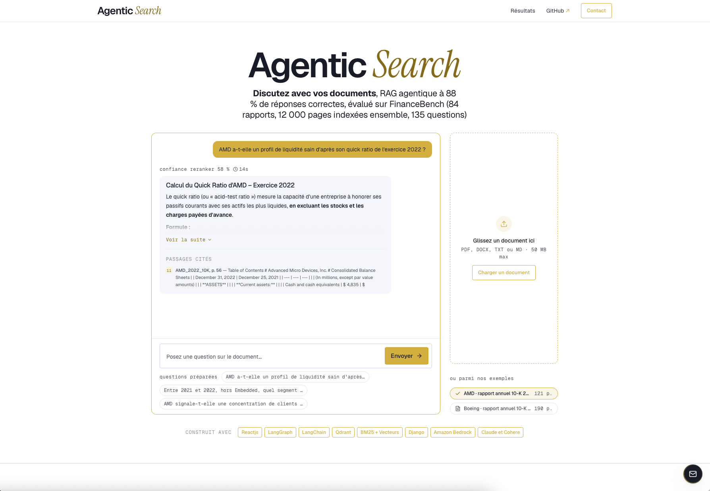
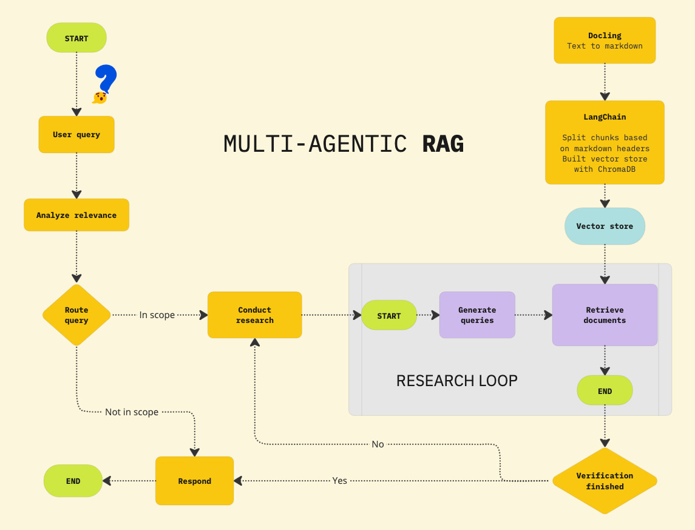

# RAG agentique évalué à 88 % de réponses correctes sur FinanceBench (84 rapports, 12 000 pages)


Si vous appréciez, ajoutez une ⭐ au repo pour soutenir mon travail. 🙏

Ce système RAG combine un récupérateur hybride (BM25 + embeddings dans Qdrant, reranking Cohere), un routage
par document et un modèle de réponse équipé d'outils de navigation (`search` / `grep` / `read_page` / `open_doc` /
`navigate`). Il est **mesuré** sur [FinanceBench](https://github.com/patronus-ai/financebench) (Patronus AI) :
les **84 rapports SEC** des questions open source (10-K, 10-Q, résultats, 8-K), soit **12 000 pages indexées
ensemble** dans un seul index.

- **88,1 % de réponses correctes** sur le corpus complet (119 sur 135 questions jugées), 11,1 % de
  réponses fausses, 1 refus ; **92,3 %** sur le pilote des 20 rapports qui portent le plus de questions.
- **Les outils de navigation font gagner 29 points pour 4 secondes de plus** : à retrieval identique, sur
  les mêmes 65 questions, 53,8 % de réponses correctes sans outils, 83,1 % avec ; −63 % de réponses
  fausses ou refusées.
- **≈ 0,07 $ par question** (Claude Sonnet 4.6 sur Bedrock, ≈ 18 000 tokens).

Tous les chiffres sont vérifiables question par question dans les expériences LangSmith du
12 octobre 2026 — [résultats, coût et limites](#évaluation-financebench-documents-financiers-difficiles).

## Architecture IA à la base avant améliorations



### 1. **Agent Vérificateur de Pertinence**
Évalue si les passages récupérés répondent réellement à la question (CAN_ANSWER / PARTIAL / NO_MATCH). Son verdict ne bloque plus la génération : il est transmis au modèle de réponse comme indice (« le contexte initial a été jugé partiel, cherchez ce qui manque »).

### 2. **Agent de Recherche et de réponse, avec outils**
Le modèle de génération reçoit les 10 meilleurs passages et les [cinq outils](#les-outils) décrits plus bas. Il répond directement si le contexte suffit ; sinon il cherche — en voyant chaque résultat avant de décider du suivant, 5 appels au plus — et répond **dans la même conversation** : le modèle qui cherche est celui qui répond. Les outils sont disponibles sur **toutes** les questions ; le mode conditionnel (agent de recherche séparé, ou réécriture de la question) reste disponible pour comparaison via `GENERATOR_TOOLS_ENABLED` et `CORRECTIVE_MODE`.

### 3. **Génération contrainte**
La réponse ne s'appuie que sur les passages numérotés — initiaux ou ramenés par les outils — avec une citation `[n]` après chaque affirmation, et refuse quand l'information n'y est pas. Les règles du prompt (`backend/agents/research_agent.py`) sont des principes valables pour tout document : la réponse précise dès la première phrase, Oui / Non tranché pour une question fermée, une seule réponse, le calcul de ce qui se calcule, la section consacrée au sujet plutôt qu'une mention en passant, « non disponible » seulement si le document ne dit rien du sujet. Les conventions propres aux rapports financiers (ratios, net income attribuable, litiges, exercices fiscaux) forment un bloc à part, ajouté seulement quand le contexte contient un rapport financier.

## Cet agent a des outils à dispo

Cinq opérations façon système de fichiers, données au modèle de réponse, définies dans `backend/tools/tools.py`. Les pages OCR sont conservées entières (`backend/retriever/page_store.py`) à côté des chunks : les chunks servent à *trouver*, les pages à *lire*.

| Outil | Ce qu'il fait |
|---|---|
| `search(query, doc)` | Le retrieval hybride du pipeline (BM25 + vecteurs dans Qdrant, routage, rerank Cohere), relancé avec une nouvelle requête, optionnellement restreint à un document. Renvoie 8 extraits avec document et page. |
| `grep(pattern, doc)` | Occurrences littérales d'un motif (regex, insensible à la casse), page par page, sur tout le document. Exhaustif : 0 résultat permet d'affirmer qu'un terme n'y figure pas. Sans `doc`, reste dans les documents ciblés par le routeur. |
| `read_page(doc, page, end_page)` | La page entière telle que l'OCR l'a produite, tableau compris — ce qu'un chunk de 1 200 caractères ne montre jamais. `end_page` lit 2 à 3 pages d'un coup pour un tableau à cheval. |
| `open_doc(doc)` | Le plan du document — PART, ITEM, états financiers consolidés, notes — avec la page de chaque section, et son nombre de pages. Sans `doc`, la liste des documents. Les niveaux d'en-têtes de l'OCR n'étant pas fiables (200 à 550 titres par 10-K), le plan retient les repères structurels par leur intitulé. |
| `navigate(doc, section)` | La page où commence une section, cherchée dans les **titres** seulement (« consolidated balance sheet », « income taxes ») : là où `grep` renvoie aussi le sommaire et les renvois, `navigate` pointe l'état financier lui-même. |

`open_doc` et `navigate` indiquent où lire sans ramener de passage ; le modèle enchaîne avec `read_page`. Aucun document n'est « ouvert » entre deux appels : chaque outil reçoit `doc`. Chaque passage ramené par `search` ou `read_page` reçoit un numéro `[n]`, affiché dans le résultat, que la réponse cite comme les autres. Les 10 passages initiaux gardent leurs numéros : les outils ne peuvent qu'**ajouter** après eux. Le rapport de vérification renvoyé avec chaque réponse liste les appels effectués.

### Le système inclut un retriever hybride pour maximiser la pertinence
- **Algo BM25 + Embeddings, côté Qdrant** : chaque chunk porte un vecteur sparse BM25 (précision lexicale) et un vecteur dense (sens contextuel) ; les deux recherches sont fusionnées par RRF dans une seule requête Qdrant. Métrique explicite (`VECTOR_SPACE = "cosine"`).
- **Un espace par utilisateur** : une collection Qdrant partagée, chaque point porte un `tenant_id` (index `is_tenant`), HNSW désactivé globalement (`m=0`) et construit par tenant (`payload_m`). Toutes les lectures passent par `backend/vectorstore/qdrant_store.py`, qui impose le filtre `tenant_id`. Les documents sont persistés : un fichier déjà indexé n'est ni ré-OCRisé ni ré-embeddé. L'index d'évaluation (FinanceBench) a ses propres collections, `eval_chunks` / `eval_pages` : il ne côtoie jamais les documents des utilisateurs (`chunks` / `pages`).
- **Routage par document** : avant de chercher, le système cible le(s) document(s) que la question désigne (nom d'entreprise ou de fichier) — indispensable quand plusieurs documents longs sont indexés ensemble.
- **Reranking Cohere + parent-child + multi-query** : petits chunks pour matcher, gros chunks pour répondre.

## Stack de modèles
Claude et les embeddings passent, au choix (`MODEL_PROVIDER`), par **Amazon Bedrock** (région
`eu-west-3`, par défaut) ou directement par les **API Anthropic et Cohere**. Les mêmes modèles
dans les deux cas :
- 💎 Claude Sonnet 4.6 (recherche à outils + génération) + Claude Haiku 4.5 (sous-agents : pertinence, routage, multi-query)
- ⚖️ Évaluation, toujours sur Bedrock : Qwen3 235B (juge LLM, à Francfort, calibré sur annotation humaine) et Ministral 3 14B (answer relevancy, en eu-west-1). Hors famille Claude : le juge ne note pas sa propre famille
- 🧠 Cohere Embed v4 (embeddings, 1024 dimensions) — identique des deux côtés : changer de fournisseur ne demande pas de réindexer
- 🧠 Cohere Rerank 3.5 (absent de Paris : appelé à Francfort, données en UE). En mode `direct` : Cohere Rerank 4 Pro par l'API Cohere

Toujours par leur propre API :
- ⚡ Mistral OCR (absent de Bedrock)
- 🗄️ Qdrant Cloud (base vectorielle, un espace et un HNSW par utilisateur)

## Installation

1. **Cloner le projet** :
```bash
git clone https://github.com/julienlucas/agentic-rag-with-tools
```

2. **Installer les dépendances** :
```bash
uv sync
```

3. **Configuration** :

Choisissez d'abord le fournisseur des modèles Claude et des embeddings :

| `MODEL_PROVIDER` | Claude (Sonnet 4.6, Haiku 4.5) | Embeddings (Cohere Embed v4) | Prérequis |
|---|---|---|---|
| `bedrock` (défaut) | Amazon Bedrock | Amazon Bedrock | Compte AWS avec `bedrock:InvokeModel`, accès activé dans la console Bedrock à Claude Sonnet 4.6, Claude Haiku 4.5 et Cohere Embed v4 |
| `direct` | API Anthropic | API Cohere | Clé [platform.claude.com](https://platform.claude.com) |

Dans tous les cas :
- **Mistral** : une clé sur [console.mistral.ai](https://console.mistral.ai), pour l'OCR.
- **Cohere** : une clé sur [dashboard.cohere.com](https://dashboard.cohere.com), pour le reranker (et les embeddings en mode `direct`).
- **Qdrant** : un cluster sur [cloud.qdrant.io](https://cloud.qdrant.io) (AWS, région proche d'eu-west-3). Sans `QDRANT_URL`, Qdrant tourne en mémoire (données perdues au redémarrage).

Fichier `.env` :
```bash
# --- Fournisseur des modèles : bedrock (défaut) ou direct ---
MODEL_PROVIDER=bedrock

# --- Toujours requis ---
MISTRALAI_API_KEY=votre_clé_api_mistral_ici      # OCR
QDRANT_URL=https://xxxx.eu-central-1-0.aws.cloud.qdrant.io:6333
QDRANT_API_KEY=votre_clé_qdrant_ici

# --- MODEL_PROVIDER=bedrock ---
# Facultatif si ~/.aws/credentials ou un rôle IAM suffit. Présentes ici, ces clés passent
# AVANT les variables AWS du shell (un AWS_SESSION_TOKEN expiré dans le terminal ne gêne plus).
AWS_ACCESS_KEY_ID=...
AWS_SECRET_ACCESS_KEY=...
AWS_REGION=eu-west-3

# --- MODEL_PROVIDER=direct ---
ANTHROPIC_API_KEY=votre_clé_api_anthropic_ici
COHERE_API_KEY=votre_clé_api_cohere_ici          # embeddings et reranker
```

Réglages facultatifs (valeurs par défaut) :
```bash
# Identifiants de modèles : vides = défaut du fournisseur choisi.
#   bedrock : eu.anthropic.claude-sonnet-4-6, eu.anthropic.claude-haiku-4-5-20251001-v1:0, eu.cohere.embed-v4:0,
#             cohere.rerank-v3-5:0 (dans RERANK_REGION=eu-central-1)
#   direct  : claude-sonnet-4-6, claude-haiku-4-5, embed-v4.0, rerank-v4.0-pro
REASONING_MODEL_ID=
MODEL_SMALL_ID=
MODEL_ID=
EMBEDDING_MODEL_ID=
REASONING_EFFORT=medium          # low | medium | high | max
RERANK_MODEL=
RERANK_REGION=eu-central-1       # Bedrock : Rerank 3.5 n'existe pas à Paris
BM25_LANGUAGE=english            # langue du stemmer BM25 (réindexer si on la change)
TENANT_MAX_DOCUMENTS=50          # quotas par espace utilisateur
TENANT_MAX_CHUNKS=20000
QDRANT_CHUNKS_COLLECTION=chunks  # collections créées automatiquement au premier démarrage
QDRANT_PAGES_COLLECTION=pages
DOCUMENT_STORAGE_DIR=document_storage  # originaux déposés ; en prod, un volume Railway (ex. /data/documents)
```

### Ouvrir une citation dans le document

Un clic sur une citation `[n]` ou sur un passage cité ouvre le document à la page citée, le
passage surligné (pdf.js, `frontend/src/components/rag/DocumentViewer.tsx`).

- **Originaux.** Un fichier déposé est gardé dans `DOCUMENT_STORAGE_DIR`, rangé par hash de
  contenu, et servi par `GET /api/documents/<hash>/file`, seulement à l'espace qui l'indexe.
  Il est effacé quand plus aucun espace ne l'indexe. Chaque chunk porte `file_hash` et
  `pdf_url` dans ses métadonnées Qdrant. Les exemples sont servis par le frontend (`/static/`).
- **Repli.** Sans original (document déposé avant ce stockage), le panneau affiche le texte OCR
  de la page (`GET /api/documents/page`), passage surligné.
- **Exemples.** AMD et Boeing (10-K 2022, FinanceBench) sont livrés avec leurs pages déjà OCRisées
  (`static/*.ocr.json`) : pas d'OCR à leur chargement. Un document déjà indexé à l'identique dans
  un autre espace y est recopié avec ses vecteurs, sans OCR ni embeddings.
- **En production (Railway)** : attacher un volume au service backend (par exemple monté sur
  `/data`), puis définir `DOCUMENT_STORAGE_DIR=/data/documents`. Sans volume, les originaux sont
  perdus à chaque redéploiement et les citations retombent sur le texte OCR.

Pour surveiller votre application avec LangSmith (si vous le souhaitez) :

1. **Créer un compte LangSmith** : Allez sur [smith.langchain.com](https://smith.langchain.com)

2. **Obtenir votre clé API** : Dans les paramètres de votre compte

3. **Ajouter vos variables d'environnement**
```bash
# Configuration LangSmith pour le monitoring
LANGSMITH_API_KEY=votre_cle_api_langsmith_ici
LANGSMITH_PROJECT=agentic-search
```

4. **Lancer l'application** :
```bash
uv run python manage.py runserver
```

## Votes des utilisateurs : de 👎 au test de non-régression

Sous chaque réponse, un 👍 / 👎 (le 👎 ouvre un commentaire facultatif). Actifs seulement avec
`LANGSMITH_API_KEY` : chaque question est tracée dans le projet `agentic-search` sous un run racine
`question`, et le vote devient un feedback `user_score` (1 / 0) sur cette trace. Le navigateur ne voit
qu'un jeton signé qui lie la trace à son espace : en production, définir `DJANGO_SECRET_KEY`.

1. **Récolter** : chaque vote est rangé automatiquement, en arrière-plan, dans le dataset LangSmith
   « agentic-search · Retours utilisateurs » (`backend/evals/feedback/votes_dataset.py`), quelques secondes après le clic, le temps
   que la trace arrive. Un 👍 y entre avec sa réponse comme référence. Un 👎 y entre avec sa réponse
   rejetée et le commentaire en métadonnées. `uv run python backend/evals/feedback/collect.py` rattrape les
   votes manqués (redémarrage du serveur, LangSmith indisponible), sans doublon.
   `FEEDBACK_AUTO_COLLECT=false` coupe le rangement automatique.
2. **Analyser** : chaque 👎 reçoit une cause d'échec proposée par le juge (Qwen3 235B, pas Claude) :
   `mauvais_document`, `passage_manquant`, `erreur_lecture`, `erreur_calcul`, `refus_a_tort`,
   `hors_corpus`, `forme` ou `autre`. Elle est aussi posée en feedback `failure_category` sur la trace,
   et `collect.py` affiche la répartition de ce qu'il rattrape. La cause dit où corriger : routage, retrieval, prompt ou outils.
3. **Corriger** : `uv run python backend/evals/feedback/replay.py` rejoue les exemples qui ont une
   référence, sur les mêmes documents du même espace, et les juge. Un 👍 qui n'est plus retrouvé est
   une **régression** (code de sortie 1). Un 👎 dont on a écrit la bonne réponse dans `outputs.answer`
   (depuis LangSmith) passe en `CORRIGÉ` le jour où le système la trouve. Chaque rejeu est enregistré
   comme expérience du dataset, comparable aux précédentes (rien n'est écrit en local).

Les réponses 👍 ne sont pas injectées dans le prompt comme exemples : elles viennent des documents
d'un utilisateur et fuiraient vers les autres espaces. Elles servent de références de test.

## Les 3 évaluations de l'agent (dans LangSmith)

**1. Les vraies questions** — *tout seul, à chaque question*

4 juges (Claude Sonnet 4.6 sur Bedrock) relisent chaque question posée en production et disent oui
ou non : l'agent a-t-il bien choisi entre chercher et répondre (`tool_selection`) ? le
vérificateur de pertinence a-t-il donné le bon label (`relevance_check_correct`) ? la réponse
ne dit-elle que ce qu'il y a dans les passages (`faithfulness`) ? répond-elle à la question
posée (`answer_relevance`) ? ~0,01 à 0,04 $ par question. Les règles se créent une fois avec
`backend/evals/online_evaluators.py`, après avoir ajouté `AWS_ACCESS_KEY_ID` et
`AWS_SECRET_ACCESS_KEY` dans LangSmith (Settings → Secrets). Le juge est de la même famille que
l'agent : choix assumé de tout passer par Bedrock (avant le 11 oct. 2026 : Mistral Large). `backend/evals/judge_calibration.py` mesure ensuite l'accord de ces juges
avec les 👍/👎 (lecture seule, gratuit).

Un seul projet LangSmith, `agentic-search` : les vraies questions, et tout ce que produisent les
évaluations, filtrable par tag (`eval` pour les résumés de runs, `evaluator` pour les évaluateurs
des expériences). Les juges en ligne ne laissent pas de trace à part : leur verdict et leur
raisonnement sont sur la trace notée.

**2. Les expériences** — *à la main, avant de merger un changement*

FinanceBench (ci-dessous) : le pilote de 20 rapports (65 questions) avec et sans outils, ~6 $ ;
le corpus de 84 rapports avec outils, ~10 $. `--ids` ne relance que les questions listées.
`--reps 3` rejoue
chaque génération 3 fois et ajoute la stabilité : exactitude moyenne, part des questions
justes à chaque fois (pass^k), stabilité du verdict.

**3. La convergence** — *à la main*

La même question FinanceBench (quick ratio d'AMD) formulée de 15 façons : l'agent
trouve-t-il la bonne réponse, et par le chemin le plus court ? Une note de 0 à 1 par
exécution (1 = bonne réponse en un minimum d'appels d'outils, 0 = réponse fausse).
~0,50 $. `uv run python backend/evals/convergence.py`

## Évaluation FinanceBench (documents financiers difficiles)

L'évaluation, sur [FinanceBench](https://github.com/patronus-ai/financebench) (Patronus AI) :
QA sur des filings SEC denses en tableaux, où chaque chiffre apparaît des dizaines de fois.

### Récupérer et indexer le jeu d'évaluation (une seule fois)

Rien n'est livré dans le dépôt : ni PDF, ni questions, ni index. Une seule commande refait tout
à partir des sources publiques, et range chaque morceau à sa place.

**1. Prérequis dans le `.env`** — le script les vérifie avant tout appel payant :

| Variable | Sert à |
|---|---|
| `LANGSMITH_API_KEY` | écrire le dataset de questions dans LangSmith |
| `MISTRALAI_API_KEY` | l'OCR des documents listés dans `FULL_OCR_DOCS` (Mistral OCR) |
| `QDRANT_URL`, `QDRANT_API_KEY` | l'index persistant (sans `QDRANT_URL`, Qdrant tourne en mémoire et l'index serait perdu) |
| AWS (`MODEL_PROVIDER=bedrock`) ou `COHERE_API_KEY` (`direct`) | les embeddings Cohere Embed v4 des chunks |

**2. Lancer la préparation** :
```bash
uv run python backend/evals/financebench/prepare.py --docs all     # 84 rapports, 139 questions
uv run python backend/evals/financebench/prepare.py --docs pilot   # 20 rapports, 65 questions
```

**3. Ce qui se passe** :

1. **Téléchargement** des 150 questions open source et des rapports depuis le
   [GitHub de FinanceBench](https://github.com/patronus-ai/financebench).
2. **Texte page par page** : le markdown OCR du dataset Hugging Face
   [`shhdwi/financebench-markdown`](https://huggingface.co/datasets/shhdwi/financebench-markdown), recalé sur
   les pages du PDF (`markdown_corpus.py`). Un document dont les tableaux y sont corrompus est OCRisé en
   entier par Mistral OCR (`FULL_OCR_DOCS` dans `prepare.py` : aujourd'hui le 10-Q T2 2023 de 3M).
3. **Dataset LangSmith** (« agentic-search · FinanceBench (84 docs) » ou « (pilot 20) ») : questions,
   réponses de référence, pages et passages de preuve. Les questions dont la preuve tombe sur une page
   absente du texte sont retirées (11 sur 150). Deux références FinanceBench fausses, vérifiées dans le
   document, sont corrigées (`REFERENCE_CORRECTIONS`, Pfizer / Upjohn).
4. **Indexation Qdrant** dans les collections d'évaluation `eval_chunks` (chunks + embeddings dense
   et BM25) et `eval_pages` (pages, pour les outils grep / read_page), séparées des documents des
   utilisateurs (`chunks` / `pages`).

Relancer le script ne repaie rien : un rapport déjà présent dans l'index est sauté.
`--reindex DOC` ré-indexe un document dont le texte a changé ; l'ancienne version est remplacée.

**Lancer l'évaluation** :
```bash
uv run python backend/evals/experiment.py --mode agentic --dataset "agentic-search · FinanceBench (84 docs)" --time-budget 0
uv run python backend/evals/experiment.py --mode both --dataset "agentic-search · FinanceBench (pilot 20)" --time-budget 0
```

### Résultats (12 octobre 2026)

Modèle de réponse : Claude Sonnet 4.6 sur Bedrock, Claude Haiku 4.5 pour les sous-agents. Juge :
Qwen3 235B, calibré sur annotation humaine. Tous les rapports d'un jeu sont dans le même index : le
système doit d'abord trouver le bon rapport. Comptages bruts entre parenthèses.

| | Correctes | Fausses | Refus |
|---|---|---|---|
| **Corpus complet**, avec outils : 84 rapports, 12 000 pages, 135 questions jugées | **88,1 % (119)** | 11,1 % (15) | 0,7 % (1) |
| **Pilote**, avec outils : 20 rapports, 3 048 pages, 65 questions | **92,3 % (60)** | 7,7 % (5) | 0 |
| RAG naïf — papier FinanceBench (GPT-4-Turbo 2023, benchmark complet) | ~19 % | 81 % de réponses fausses ou refusées | |

Expériences LangSmith : « eu.anthropic.claude-sonnet-4-6 · agentic · 2026-10-12 14:26 » (84 rapports) et
« … · 13:46 » (pilote). Sur les 139 questions du corpus complet, 4 n'ont pas abouti, bloquées par le
quota quotidien de tokens Bedrock : elles ne sont pas comptées. Trois échecs viennent d'un index
de 84 rapports pas encore mis à jour lors du run (références Pfizer corrigées, 10-Q de 3M ré-OCRisé),
corrigé depuis par `prepare.py --docs all --reindex 3M_2023Q2_10Q`. L'intervalle de confiance à 95 %
de l'exactitude va de 82 à 93 %.

**Ce que les outils de navigation apportent.** Ablation à retrieval identique, même run (« … · 13:16 »),
pilote de 20 rapports, mêmes 65 questions, même modèle ; la seule différence est le modèle de réponse
avec ou sans outils :

| | Sans outils | Avec outils |
|---|---|---|
| Réponses correctes | 53,8 % (35) | 83,1 % (54) |
| Réponses fausses ou refusées | 30 (15 fausses, 15 refus) | 11 (11 fausses, aucun refus) |
| Génération par question | 7,0 s | 11,0 s |
| Tokens lus par question (Sonnet 4.6) | ≈ 3 000 (estimation) | ≈ 18 000 |

Soit **+29 points pour +4 secondes**, et **−63 % de réponses fausses ou refusées**. Face à une réponse en
une seule passe, l'agent lit des pages entières : il consomme plus de tokens, c'est le prix de la précision.

**Ce qui échoue encore** (corpus complet) : des conventions de calcul que les références n'appliquent
pas toujours de la même façon (quick ratio, fonds de roulement, rotation des stocks), le routage quand la
question nomme mal l'entreprise parmi 84, quelques erreurs de lecture de tableau, et trois questions à
référence ambiguë (CVS, Best Buy, Ulta).

**Coût.** Le runner compte les tokens facturés de chaque appel et les unités de recherche Cohere, et
écrit le total dans le résumé du run (LangSmith, tag `eval`). Runs du 12 octobre 2026, avec outils seul :

| Run | Claude Sonnet 4.6 | Haiku 4.5 + Cohere Rerank | Total |
|---|---|---|---|
| Pilote, 65 questions (10 min) | 1,15 M tokens en entrée, 58 k en sortie : 4,33 $ | 0,28 $ | **4,61 $** |
| Corpus complet, 139 questions (35 min) | 2,46 M tokens en entrée, 102 k en sortie : 8,93 $ | 0,67 $ | **9,60 $** |

Soit ≈ 0,07 $ par question. Le juge Qwen3 et Ministral (answer relevancy) ne sont pas chiffrés par le
script : quelques dizaines de centimes de plus par run. `--mode both` ajoute la baseline sans outils
(≈ +1 $ sur le pilote). Grilles Bedrock (3 $ / 15 $ par million de tokens pour Sonnet 4.6), 1 $ = 0,86 €.


Détail du protocole, options et notes d'implémentation : [`backend/evals/financebench/README.md`](backend/evals/financebench/README.md).
